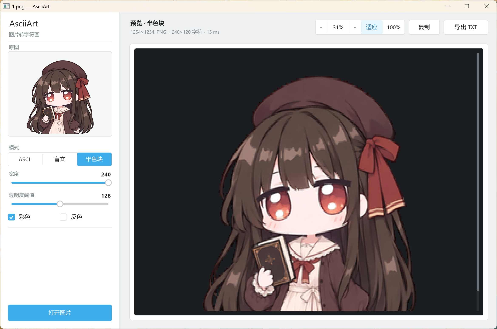
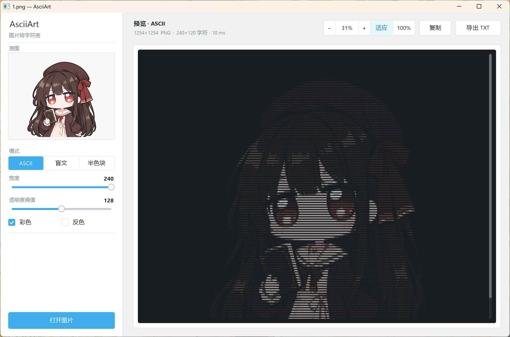
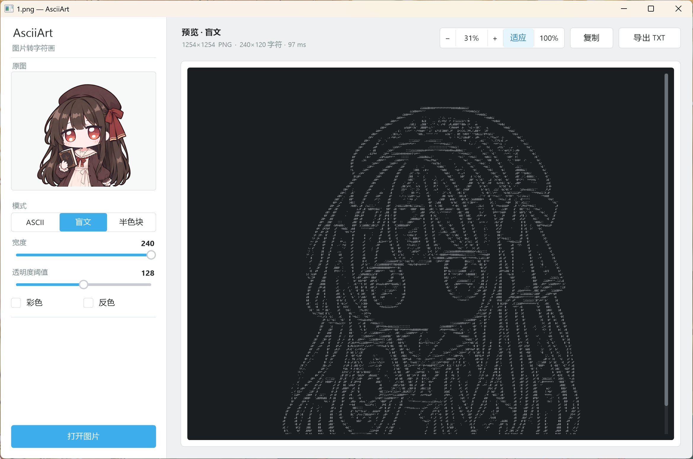

# AsciiArt

把图片转换成终端字符画。提供单文件命令行工具和 Windows 图形界面程序两个版本。

三种模式都保留原始颜色，支持透明 PNG，也可以输出纯文本。



## 三种模式

| 模式 | 命令 | 原理 |
|------|------|------|
| ASCII | `-m ascii` | 按亮度映射到字符梯度 ` .:-=+*#%@`，每个字符代表 1×2 像素 |
| 盲文 | `-m braille` | 每个字符是 2×4 点阵，用局部自适应阈值决定在哪些点阵位置绘制圆点，纵向分辨率是 ASCII 的 4 倍 |
| 半色块 | `-m blocks` | 用 `▀` 的上半部分当前景色、下半部分当背景色，一个字符表示两个像素 |

| ASCII | 盲文 |
|---|---|
|  |  |

## 快速开始

### 命令行

```bash
# 默认输出三种模式到终端
asciiart photo.jpg

# 只输出半色块，宽度 120，关闭颜色
asciiart photo.jpg -m blocks -w 120 --no-color

# 盲文模式写入文件
asciiart logo.png -m braille -w 100 -o logo.txt

# 三种模式分别写文件：result_ascii.txt / result_braille.txt / result_blocks.txt
asciiart photo.jpg -o result.txt
```

### 图形界面

```bash
asciiart-gui                      # 空窗口，拖入图片或点击「打开图片」
asciiart-gui photo.jpg            # 直接打开
asciiart-gui -mode blocks photo.jpg -width 100
```

左侧是参数：模式、宽度、透明度阈值、彩色与反色开关。右侧实时预览，预览区可以用鼠标滚轮上下滚动、`Shift` + 滚轮左右滚动，也可以直接拖动滚动条。

右上角的缩放控件控制预览比例：

| 控件 | 作用 |
|------|------|
| 「−」 / 「+」 | 以 10% 为单位缩小或放大 |
| 中间的百分比 | 点击后可输入任意比例，回车确认，`Esc` 取消 |
| 「适应」 | 自动缩放到刚好填满预览区 |
| 「100%」 | 回到 1:1 |

「复制」把当前字符画复制到剪贴板，「导出 TXT」保存为文件。快捷键：`Ctrl+O` 打开、`Ctrl+S` 导出、`Ctrl+C` 复制、`←`/`→` 微调宽度。

## 命令行参数

| 参数 | 说明 |
|------|------|
| `-m, --mode` | `ascii` \| `braille` \| `blocks` \| `all`（默认 `all`），也接受 `a`/`b`/`c` |
| `-w, --width` | 输出字符宽度，1–400，默认 80 |
| `-a, --threshold` | 透明度阈值，0–255，默认 128；低于该值视为透明 |
| `-c, --colored` | 强制输出 24 位 ANSI 颜色 |
| `--no-color` | 强制关闭颜色 |
| `-i, --invert` | 反转亮度（ASCII 模式） |
| `-o, --output` | 写入文件；`all` 模式自动加 `_ascii` / `_braille` / `_blocks` 后缀 |
| `--charset` | 自定义 ASCII 字符集，按从暗到亮排列，至少 2 个可打印字符 |
| `--bg` | 透明区域的背景色，`#RRGGBB`，默认 `#000000` |
| `--sigma` | 盲文自适应阈值的模糊半径，默认 3.0 |
| `--sharpen` | 盲文锐化强度，1.0 表示不锐化，默认 1.2 |
| `--contrast` | 盲文对比度，1.0 表示不调整，默认 1.5 |
| `--k` | 盲文阈值偏移量，以局部标准差为单位，默认 0.4 |
| `--scale` | 半色块高度相对宽度的缩放比例，默认 1.0 |

不指定 `-o` 时结果只写到标准输出，不会在当前目录留下任何文件。

## 构建

需要 Go 1.27 或更高版本。

```bash
# Git Bash / MSYS2 / WSL
./scripts/build.sh              # 构建两个可执行文件到 dist/
./scripts/build.sh --package    # 额外生成 zip 与 SHA256 校验值

# PowerShell
.\scripts\build.ps1 -Package
```

装了 `make` 的话也可以用 `make all` / `make package` / `make release`。

产物：

```
dist/asciiart.exe                       单文件命令行工具
dist/asciiart-gui.exe                   Windows 图形界面程序（无控制台窗口）
dist/asciiart-<version>-windows-amd64.zip
dist/SHA256SUMS.txt
```

构建脚本会依次执行 `gofmt` 检查、`go vet`、`go test`，任何一步失败都会中止。

## 限制

由于可能存在异常图片，因此解码前会先校验，超过限制会报错：

- 支持 PNG / JPEG / GIF，按文件内容判断格式
- 单个文件最大 64 MiB
- 解码后最多 4000 万像素，单边不超过 20000 像素
- 输出宽度 1–400，字符网格最多 240000 个单元格

> 构造失败的字符画会自动清理临时文件。

## 项目结构

```
cmd/asciiart/        命令行入口
cmd/asciiart-gui/    图形界面入口
internal/limits/     资源上限
internal/safedecode/ 解码：格式判断 + 尺寸校验
internal/render/     渲染：重采样、高斯模糊、三种模式
internal/ansi/       字符网格 → 文本 / ANSI 转义
internal/artio/      写文件
internal/cli/        参数解析与流程编排
gui/                 Win32 + GDI+ 自绘界面
tools/package/       打包 zip 与校验值
```

## 许可证

采样算法参考了 `MurthiNext/img2text` 项目（Python 实现）

[GPL-2.0 license](LICENSE)
